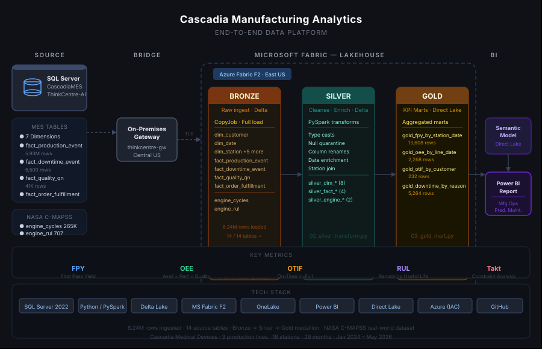

Cascadia is a portfolio of end-to-end analytics work: the data systems, and the metric and governance layers that decide what the numbers on top of them mean. The pieces do not share an architecture. They share a standard, and each uses the tools that fit its problem and its scale.

---

::: {.cci-family-callout}
[New build / Healthcare]{.fx-eyebrow}

## A ride record is not a claim.

**Cascadia Claim Integrity** follows supported facts into claim construction, then downstream encounter readiness and outcome evidence. Expected work remains visible when a record never arrives.

[Read the case study](https://www.robbinsanalytics.com/cascadia-claim-integrity/case-study.html){.fx-btn .fx-btn--dark} [Open the module](https://www.robbinsanalytics.com/cascadia-claim-integrity/){.fx-btn .fx-btn--outline}

Frozen synthetic demonstration. Testing results and accepted limitations are published with the build.
:::

## How I Built This

I set the architecture, the data model and the measurement definitions as a written specification. AI coding agents build to that specification in Python. I do not hand-write the Python. My role is to write the spec, review the output, and validate it.

The controls are explicit, and their evidence travels with each build. Their scope and actual outcomes matter as much as their existence.

**Independent derivation checks the definition.** Earlier SQL-backed modules compare published measures with a separately written calculation. Claim Integrity matched all 22,173 published cells in its second path, while retaining a recorded fail for that surface. Numerical agreement does not turn every assurance requirement green.

**Chart review and reading evidence state their conditions.** Earlier builds record reviews against the visualization standard and panel exposure conditions. Claim Integrity is accepted as a frozen synthetic portfolio build with current chart re-review deferred and four minor clarity items open in a restricted simulated panel. That panel is not evidence from blind human readers.

What the builds are allowed to read is a boundary rather than a limitation. Three sources: the specifications, data models and standards written for these builds; public datasets from CMS, SEC EDGAR, NASA, BLS and FDA; and synthetic operational data, labeled as synthetic on every page that shows it. No confidential internal business data goes into any of it, deliberately.

One failure is worth naming, because it is the honest shape of an AI failure rather than the dramatic one. Bumping a version number across a build is the kind of mechanical edit that looks safe to delegate. Twice in two days an agent-executed bump left stale references behind, and the second pass corrected two of them while creating four more. Nothing errored. Nothing looked broken. Any check that only asks whether the code still runs would have passed all four times.

What catches it is grepping for the previous version before calling the bump finished, and then reading every surviving hit rather than counting them, because most surviving mentions of an old version are supposed to survive.

That control is still an instruction and not an automated check, and an instruction is precisely the control that had already failed twice. The automated version of it is written up as a proposal. It is not built.

---

## The Builds & Their Stacks

::: {.table-scroll tabindex="0"}

| Domain | Status | Stack | Data | Headline Skill |
|---|---|---|---|---|
| [Cascadia Claim Integrity](https://www.robbinsanalytics.com/cascadia-claim-integrity/case-study.html) | Published | Python → JSON/JSONL → static JavaScript and SVG | Frozen synthetic ride, claim, submission and response records | Claim construction from supported facts; downstream encounter readiness; independent expected-work accounting, with accepted assurance limits |
| [Cascadia Early Warning](https://www.robbinsanalytics.com/cascadia-early-warning/case-study.html) | Published | Python → DuckDB → statsmodels → static ECharts, with a second derivation path and a live edge that runs weekly from publication | openFDA device event, recall, enforcement and classification endpoints. Public FDA records (real) | Pre-specified forecasting: a locked test frozen after a documented harness repair, honest ranges, a fixed review rule, counts never rates |
| [Cascadia Revenue Assurance](projects/cascadia-revenue-assurance.qmd) | Published | Python → flat CSV → static ECharts, with a DuckDB re-derivation gate | Synthetic (seeded generator): a subscription-licensing book, with no real company, customer or partner | Two derivation paths from one rules document, agreeing on every cell; the auto-renewed terms no transaction marked, derived and flagged |
| [Cascadia Fee Examiner](projects/cascadia-fee-examiner.qmd) | Published | Python (stdlib) → flat CSV/JSON → static ECharts | LoPucki Bankruptcy Research Database, CourtListener RECAP, UTBMS/USTP Appendix B. Public court and research records (real) | Entity resolution across sources with no shared key; publishing what it can't resolve |
| [Cascadia Matter Ledger](projects/cascadia-matter-ledger.qmd) | Published | Python → DuckDB → static ECharts, plus a scheduled incremental pull | FJC Integrated Database and CourtListener RECAP. Public federal court records (real) | Operating a governed model: a pipeline that re-asserts its own invariants and publishes the failures |
| [Cascadia Control Tower](projects/cascadia-controltower.qmd) | Published | Python → DuckDB → dbt Core → static ECharts | Synthetic (seeded generator), anchored to BLS, Census and SEC XBRL | Metric certification / counterfactual costing |
| [Cascadia Deal Desk](projects/cascadia-dealdesk.qmd) | Published | Python → SQLite → static ECharts | Synthetic (seeded generator) | Pricing governance / exception calibration |
| [Cascadia Finance](projects/cascadia-finance.qmd) | Published | Python → SQLite → static ECharts (SEC EDGAR XBRL) | FormFactor SEC filings (real) | Financial analytics / XBRL governance |
| [Cascadia Staffing](projects/cascadia-staffing.qmd) | Case Study | Local SQL Server → Power BI | CMS PBJ Daily Nurse Staffing (real) | Marketplace labor KPIs / metric governance |
| [Cascadia Pharmacy](projects/cascadia-pharmacy.qmd) | Case Study | Local SQL Server → Power BI | CMS Part D + CDC VaxView (real) | Messy-data cleaning / GLP-1 growth |
| [Cascadia Medical Devices](projects/cascadia-medical-devices.qmd) | Case Study | SQL Server → Microsoft Fabric → Power BI | Simulated MES + NASA C-MAPSS | Predictive maintenance / OEE |
| [Cascadia Clothing](projects/cascadia-clothing.qmd) | Planned | TBD | TBD e-commerce data | Customer segmentation |

:::

> **Beyond the builds:** [Cascadia BI Migration](projects/cascadia-bi-migration.qmd) is a program design for migrating an organization off legacy BI onto a governed, AI-assisted platform, with a certified metric layer at the center. [Cascadia Operating Charter](projects/cascadia-operating-charter.qmd) is an operating charter: how I would run a data, analytics and automation team, with a proof, a test and a mark on every practice. [Validating AI-Assisted Analytics](https://www.robbinsanalytics.com/cascadia-validation-playbook/) is a playbook: how confidence in AI-assisted code comes from a requirement, an answer specified separately from the implementation and a check that can expose a mistake, shown on an invented dispatch rule with four experiments that run a real SQL query in the browser, and real evidence pinned to the builds above. They are the three pieces here that are designs rather than data builds.

> **Not a build at all:** [The Combinatorics of Sibling Conflict](projects/sibling-conflict.qmd) is a short mathematics paper, and a pet project. No stack, no data, nothing to put in the columns above. It counts the ways n children can split into two opposing sides: (3^n^ − 2·2^n^ + 1)/2, the Stirling number S(n+1, 3).

---

## Three Patterns, One Standard

**Lightweight analytical stack.** Eight modules need neither SQL Server nor Power BI. Seven use the earlier Python and static ECharts pattern: Deal Desk, Finance, Control Tower, Matter Ledger, Fee Examiner, Revenue Assurance and Early Warning. Claim Integrity uses Python with JSON/JSONL and a static JavaScript/SVG interface that fetches its frozen local snapshot files. Its claims, source support and downstream encounter obligations are explicit records; no live data service is required. These modules circulate as links with nothing to install.

**Four of them take DuckDB, and for two different reasons.** Control Tower and Matter Ledger take it for scale, at 621,942 order lines and 10,960,173 federal case records; Early Warning takes it for both reasons at once, holding 649,080 distinct device reports and re-deriving its counts, forecasts, scores and review episodes down a second path written separately from the Python build. Control Tower adds dbt Core on top, 6 staging views, 9 marts and 69 data tests, because its transformation layer is worth a real framework; Matter Ledger does not, because its modeling is a single conformance pass over a 2.0 GB file. What Matter Ledger adds instead is a live edge: a scheduled incremental pull that reconciles against the frozen baseline on every run. Revenue Assurance takes DuckDB for neither reason. Its book of 50,110 subscription-months would fit the smaller engine comfortably. It needed a second derivation path, written separately and reconciled against the first and against golden cases, so that an implementation error in either shows as a mismatch; what the two share, the rules and the inputs, is documented as the risk the comparison does not reduce.

**Cascadia Fee Examiner is the leanest variant and has no star schema at all.** Python's standard library does the conforming: no pandas, no database, nothing but hash-verified CSV and JSON, because the problem was never about row count. What it needed was a published rule for resolving firm identity across three sources that share no key, and a policy of publishing what the rule cannot resolve.

**Pragmatic local stack.** Pharmacy and Staffing run a local SQL Server star schema with a Python raw-to-clean staging layer, suppression flags rather than zero-fill, straight into a Power BI import model. Same discipline, no cloud overhead.

**Enterprise-BI stack.** Medical Devices is the full production pattern: a SQL Server star schema feeding a Microsoft Fabric medallion lakehouse, surfaced through a Power BI Direct Lake semantic model. A semantic model is not a hostable page, so unlike the modules above there is nothing here to open. The case study is where this build is shown.

::: {.arch-container}
{fig-alt="Architecture diagram: SQL Server source systems feed a Microsoft Fabric medallion lakehouse of Bronze, Silver and Gold layers, which is surfaced through a Power BI Direct Lake semantic model."}
:::

---

## Design Principles

::: {.grid}
::: {.g-col-12 .g-col-md-6}
**Operated, not only built**
Most of these modules are frozen snapshots: pulled once, validated at build time, published. Cascadia Matter Ledger runs on a schedule, re-asserts its own invariants on every run, reconciles a live increment against the frozen baseline, and publishes the result, including when a run fails and why. A surface that has only ever shown green has demonstrated nothing.
:::
::: {.g-col-12 .g-col-md-6}
**Agreeing with yourself is not validation**
A second implementation that shares a helper shares its defects. Cascadia Revenue Assurance derives every published cell twice, by a state machine in Python and a set-based SQL path in DuckDB, each written from one rules document and neither from the other's code. A hand-computed fixture of 15 cases was committed failing before either engine existed. If the two paths disagree the defect is in the rules document, and it is fixed there first. The module publishes no correctness percentage of any kind, by decision.
:::
::: {.g-col-12 .g-col-md-6}
**An audit that cannot fail is not an audit**
A realism check that has only ever seen good data has not been tested. Control Tower's audits are pure functions of measured numbers, so the suite feeds each one deliberately wrong values: inventory inflated past the sector band, cost cut to a rounding error, splits made uniform. All six negative controls trip, and that result is published next to the real one.
:::
::: {.g-col-12 .g-col-md-6}
**Definitions live with the code that computes them**
A metric register typed by hand is documentation; one generated from the models is engineering. Cascadia Control Tower's eleven-metric register is built from the `meta` blocks on the dbt models themselves, the same file that defines their tests, and a `--check` mode fails the build if a published definition drifts from the model behind it.
:::
::: {.g-col-12 .g-col-md-6}
**Publishing an unresolved case is not a gap; dropping one would be**
Where ambiguity is internal, the build fails: Deal Desk settles contested quote lines with three documented tiebreaks, and a tie that survives all three is a data-quality defect rather than a judgment call. Where it is external, failing would mean never shipping. Fee Examiner resolves 9 of 25 firm pairs across three sources that share no key, and publishes the other 16 with the reason each one did not match. A match rate near 100% would be evidence the rule is too loose.
:::
::: {.g-col-12 .g-col-md-6}
**A test that cannot be quietly re-run**
A forecast evaluated on data the model has already seen proves nothing, and a held-out test that is re-run until it looks good proves less. Cascadia Early Warning commits its harness, its periods, its interval method and its promotion rule before the first forecast row exists, and has its validator read the git history: a locked row that ever changed, or a promotion decided after the first locked row, fails the build. One corrected result was frozen after a documented harness repair, made before any locked row was committed; promotion and point forecasts were unchanged. The result is published as it came out, including the three codes whose ranges did not hold.
:::
::: {.g-col-12 .g-col-md-6}
**Charts reviewed against a standard**
Chart reviews record their standard, result and exposure conditions. Earlier reviews led to charts being rebuilt when their titles could not be verified from the plot. Claim Integrity retains its accepted deferral and restricted simulated-panel findings in the verification view and case study, rather than inheriting a blanket review claim.
:::
:::

---

## Tech Stack

Python (pandas)
SQLite
DuckDB
dbt Core
Apache ECharts
SEC EDGAR XBRL
FJC Integrated Database
Bankruptcy Research Database
openFDA
statsmodels
Playwright
SQL Server 2025
T-SQL
Power BI
DAX
Microsoft Fabric
PySpark
Static HTML / JS
JSON / JSONL
SVG
WCAG 2.2 AA target (unverified)
GitHub Pages
PowerShell
Git

