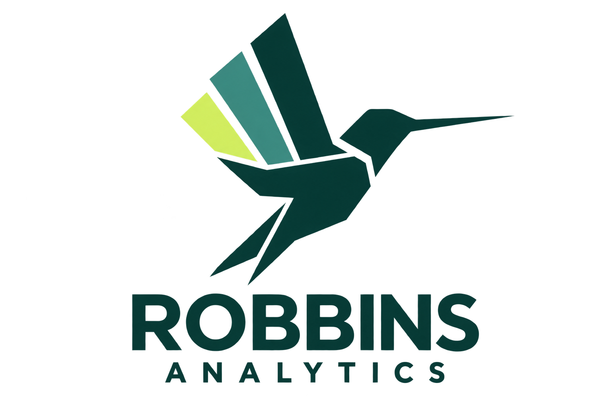
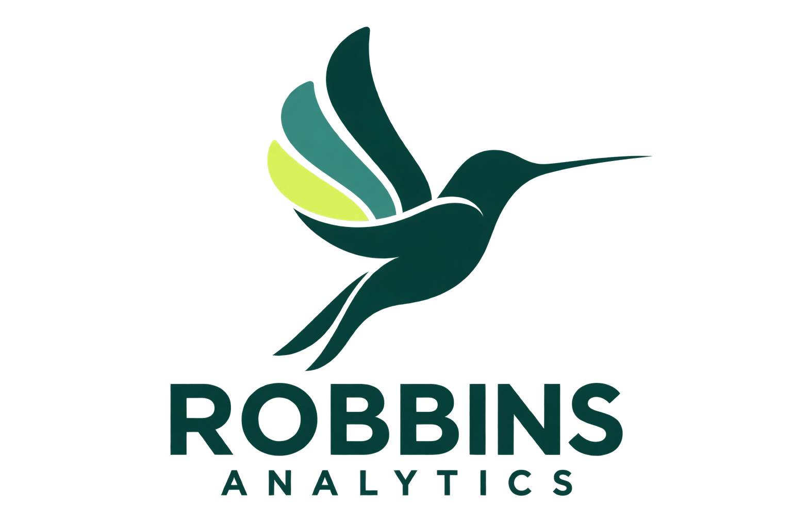

```{=html}
<div id="logo-header-comparison">

<p class="comparison-intro">Each preview uses the current Robbins Analytics paper background, wordmark placement, and navigation. Only the logo changes.</p>

<section class="logo-header-option" aria-labelledby="geometric-heading">
  <div class="logo-header-option__heading">
    <p class="logo-header-option__index">HEADER OPTION 01A</p>
    <h2 id="geometric-heading">Geometric</h2>
    <p>Angular chart feathers give the hummingbird a precise, architectural feel.</p>
  </div>
  <div class="logo-header-frame">
    <header class="logo-header-preview">
      <a class="logo-header-preview__brand" href="#geometric-heading" aria-label="Geometric logo preview">
        
      </a>
      <nav class="logo-header-preview__nav" aria-label="Geometric header navigation preview">
        <div class="logo-header-preview__links">
          <span class="logo-header-preview__link logo-header-preview__link--current">Home</span>
          <span class="logo-header-preview__link">About</span>
          <span class="logo-header-preview__link">Cascadia</span>
          <span class="logo-header-preview__link logo-header-preview__link--menu">Case Studies <span aria-hidden="true">⌄</span></span>
        </div>
        <span class="logo-header-preview__search" aria-hidden="true"></span>
      </nav>
    </header>
    <div class="logo-header-preview__hero">
      <h3><em>Aaron</em> Robbins<span>.</span></h3>
      <p>AI Analytics Architect <span>·</span> 12+ years turning messy data into decisions leaders trust.</p>
    </div>
  </div>
  <a class="logo-header-option__download" href="assets/brand/robbins-logo-signal-wing-geometric.png" download>Download Geometric PNG <span aria-hidden="true">↗</span></a>
</section>

<section class="logo-header-option" aria-labelledby="flowing-heading">
  <div class="logo-header-option__heading">
    <p class="logo-header-option__index">HEADER OPTION 01B</p>
    <h2 id="flowing-heading">Flowing</h2>
    <p>Sweeping curves make the chart wing feel fluid and agile.</p>
  </div>
  <div class="logo-header-frame">
    <header class="logo-header-preview">
      <a class="logo-header-preview__brand" href="#flowing-heading" aria-label="Flowing logo preview">
        
      </a>
      <nav class="logo-header-preview__nav" aria-label="Flowing header navigation preview">
        <div class="logo-header-preview__links">
          <span class="logo-header-preview__link logo-header-preview__link--current">Home</span>
          <span class="logo-header-preview__link">About</span>
          <span class="logo-header-preview__link">Cascadia</span>
          <span class="logo-header-preview__link logo-header-preview__link--menu">Case Studies <span aria-hidden="true">⌄</span></span>
        </div>
        <span class="logo-header-preview__search" aria-hidden="true"></span>
      </nav>
    </header>
    <div class="logo-header-preview__hero">
      <h3><em>Aaron</em> Robbins<span>.</span></h3>
      <p>AI Analytics Architect <span>·</span> 12+ years turning messy data into decisions leaders trust.</p>
    </div>
  </div>
  <a class="logo-header-option__download" href="assets/brand/robbins-logo-signal-wing-flowing.png" download>Download Flowing PNG <span aria-hidden="true">↗</span></a>
</section>

<section class="logo-header-option" aria-labelledby="monoline-heading">
  <div class="logo-header-option__heading">
    <p class="logo-header-option__index">HEADER OPTION 01C</p>
    <h2 id="monoline-heading">Monoline</h2>
    <p>A single-ink outline keeps the logo spare and understated.</p>
  </div>
  <div class="logo-header-frame">
    <header class="logo-header-preview">
      <a class="logo-header-preview__brand" href="#monoline-heading" aria-label="Monoline logo preview">
        
      </a>
      <nav class="logo-header-preview__nav" aria-label="Monoline header navigation preview">
        <div class="logo-header-preview__links">
          <span class="logo-header-preview__link logo-header-preview__link--current">Home</span>
          <span class="logo-header-preview__link">About</span>
          <span class="logo-header-preview__link">Cascadia</span>
          <span class="logo-header-preview__link logo-header-preview__link--menu">Case Studies <span aria-hidden="true">⌄</span></span>
        </div>
        <span class="logo-header-preview__search" aria-hidden="true"></span>
      </nav>
    </header>
    <div class="logo-header-preview__hero">
      <h3><em>Aaron</em> Robbins<span>.</span></h3>
      <p>AI Analytics Architect <span>·</span> 12+ years turning messy data into decisions leaders trust.</p>
    </div>
  </div>
  <a class="logo-header-option__download" href="assets/brand/robbins-logo-signal-wing-monoline.png" download>Download Monoline PNG <span aria-hidden="true">↗</span></a>
</section>

</div>

<style>
  body.logo-header-comparison main.content {
    max-width: 90rem;
    padding-bottom: 4rem;
  }

  #logo-header-comparison {
    --compare-paper: #efeee9;
    --compare-ink: #162b29;
    --compare-teal: #3f7771;
    --compare-rule: #d8d8d1;
    color: var(--compare-ink);
    font-family: var(--fx-font-sans, "Inter", "Segoe UI", sans-serif);
  }

  #logo-header-comparison .comparison-intro {
    max-width: 42rem;
    margin: 0 0 2rem;
    color: #56615d;
    font-size: 1rem;
    line-height: 1.65;
  }

  #logo-header-comparison .logo-header-option {
    margin: 0 0 2rem;
  }

  #logo-header-comparison .logo-header-option__heading {
    display: grid;
    grid-template-columns: max-content minmax(0, 1fr);
    align-items: baseline;
    column-gap: 0.8rem;
    margin: 0 0 0.75rem;
  }

  #logo-header-comparison .logo-header-option__index {
    margin: 0;
    color: #5f6e68;
    font: 500 0.7rem/1.2 var(--fx-font-mono, "JetBrains Mono", monospace);
    letter-spacing: 0.08em;
  }

  #logo-header-comparison .logo-header-option__heading h2 {
    margin: 0;
    font: 600 1.55rem/1.2 var(--fx-font-display, "Inter Tight", "Inter", sans-serif);
    color: var(--compare-ink);
  }

  #logo-header-comparison .logo-header-option__heading > p:last-child {
    grid-column: 2;
    margin: 0.2rem 0 0;
    color: #56615d;
    font-size: 0.9rem;
  }

  #logo-header-comparison .logo-header-frame {
    overflow: hidden;
    border: 1px solid var(--compare-rule);
    border-radius: 0.8rem;
    background: var(--compare-paper);
  }

  #logo-header-comparison .logo-header-preview {
    display: flex;
    min-height: 9.2rem;
    align-items: center;
    justify-content: space-between;
    gap: 1.5rem;
    padding: 0.8rem 1.5rem;
    background: var(--compare-paper);
  }

  #logo-header-comparison .logo-header-preview__brand {
    display: flex;
    width: 13.2rem;
    max-width: 24%;
    flex: 0 0 auto;
    align-items: center;
  }

  #logo-header-comparison .logo-header-preview__brand img {
    display: block;
    width: 100%;
    height: auto;
  }

  #logo-header-comparison .logo-header-preview__nav {
    display: flex;
    align-items: center;
    gap: 0.7rem;
    font-size: 0.87rem;
  }

  #logo-header-comparison .logo-header-preview__links {
    display: flex;
    align-items: center;
    gap: 0.16rem;
    padding: 0.26rem;
    border: 1px solid rgba(22, 43, 41, 0.04);
    border-radius: 999px;
    background: #fff;
    white-space: nowrap;
  }

  #logo-header-comparison .logo-header-preview__link {
    display: inline-flex;
    min-height: 2.45rem;
    align-items: center;
    padding: 0 1rem;
    border-radius: 999px;
    color: #3e4945;
  }

  #logo-header-comparison .logo-header-preview__link--current {
    background: #102a29;
    color: #fff;
    font-weight: 600;
  }

  #logo-header-comparison .logo-header-preview__link--menu span {
    margin-left: 0.55rem;
    color: #707b76;
    font-size: 1rem;
  }

  #logo-header-comparison .logo-header-preview__search {
    display: grid;
    width: 2.8rem;
    height: 2.8rem;
    flex: 0 0 auto;
    place-items: center;
    border: 1px solid rgba(22, 43, 41, 0.08);
    border-radius: 50%;
    background: #fff;
  }

  #logo-header-comparison .logo-header-preview__search::before {
    width: 0.95rem;
    height: 0.95rem;
    border: 1.6px solid #78817d;
    border-radius: 50%;
    content: "";
  }

  #logo-header-comparison .logo-header-preview__hero {
    min-height: 6rem;
    padding: 0.85rem 1.6rem 1rem;
    border-top: 1px solid rgba(22, 43, 41, 0.08);
    background: #f8f7f4;
  }

  #logo-header-comparison .logo-header-preview__hero h3 {
    margin: 0 0 0.25rem;
    color: #182521;
    font: 600 1.55rem/1.1 var(--fx-font-display, "Inter Tight", sans-serif);
  }

  #logo-header-comparison .logo-header-preview__hero h3 em {
    color: var(--compare-teal);
    font: italic 400 1.1em/1 var(--fx-font-serif, "Source Serif 4", Georgia, serif);
  }

  #logo-header-comparison .logo-header-preview__hero h3 > span {
    color: var(--compare-teal);
  }

  #logo-header-comparison .logo-header-preview__hero p {
    margin: 0;
    color: #515d57;
    font-size: 0.83rem;
  }

  #logo-header-comparison .logo-header-preview__hero p span {
    color: var(--compare-teal);
  }

  #logo-header-comparison .logo-header-option__download {
    display: inline-block;
    min-height: 2.75rem;
    margin: 0.65rem 0 0;
    padding: 0.7rem 0;
    color: var(--compare-ink);
    font-size: 0.82rem;
    font-weight: 600;
    text-decoration-color: var(--compare-teal);
    text-underline-offset: 0.22rem;
  }

  #logo-header-comparison .logo-header-option__download span {
    color: var(--compare-teal);
  }

  #logo-header-comparison a:focus-visible {
    outline: 2px solid var(--compare-teal);
    outline-offset: 3px;
    border-radius: 0.25rem;
  }

  @media (max-width: 48rem) {
    #logo-header-comparison .logo-header-option__heading {
      grid-template-columns: 1fr;
      gap: 0.25rem;
    }

    #logo-header-comparison .logo-header-option__heading > p:last-child {
      grid-column: 1;
    }

    #logo-header-comparison .logo-header-preview {
      min-height: 6.5rem;
      gap: 0.7rem;
      padding: 0.65rem;
    }

    #logo-header-comparison .logo-header-preview__brand {
      width: 8rem;
      max-width: 35%;
    }

    #logo-header-comparison .logo-header-preview__nav {
      gap: 0.4rem;
      font-size: 0.68rem;
    }

    #logo-header-comparison .logo-header-preview__links {
      gap: 0;
      padding: 0.2rem;
    }

    #logo-header-comparison .logo-header-preview__link {
      min-height: 2rem;
      padding: 0 0.42rem;
    }

    #logo-header-comparison .logo-header-preview__link--menu span {
      margin-left: 0.15rem;
    }

    #logo-header-comparison .logo-header-preview__search {
      width: 2.1rem;
      height: 2.1rem;
    }

    #logo-header-comparison .logo-header-preview__hero {
      padding-right: 0.8rem;
      padding-left: 0.8rem;
    }
  }
</style>
```
